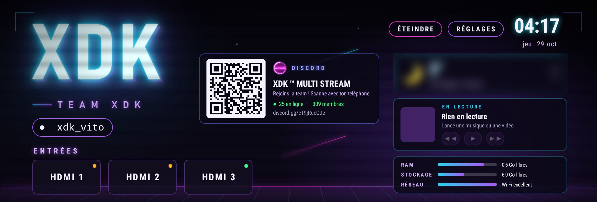
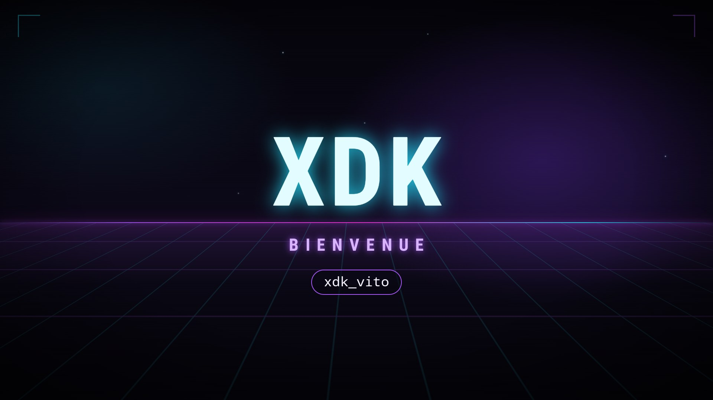
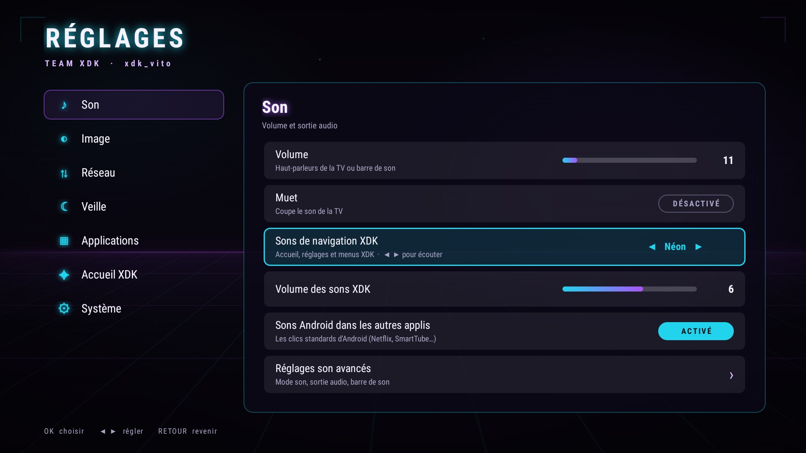

# XDK Launcher

L'accueil Android TV de la **TEAM XDK** : néon, léger et sans pub. Gratuit.

Ce dépôt contient uniquement les **téléchargements** de XDK Launcher (le code de l'appli n'est pas public).

- **Accueil néon** avec tes entrées HDMI, tes applis (maintiens OK pour les ranger, les cacher ou les désinstaller) et tes applis récentes
- **Ton pseudo** affiché sur l'accueil et dit par la voix
- **Widgets** : météo de ta ville, lecture en cours (pause / suivant), état de la TV
- **Discord TEAM XDK** : QR code à scanner et membres en ligne
- **Animation et voix** « Bienvenue » quand la TV s'allume, bouton **Éteindre** avec effet vieille télé
- **Visite guidée** à la voix au premier lancement
- **YouTube sans pub** : installe [SmartTube](https://github.com/yuliskov/SmartTube) (open source) en un clic
- **Réglages XDK** dans le même style : son, image, réseau, veille, applis, système
- **Sons de navigation** au choix : Néon, Arcade, Cristal, Sci-Fi, Discret
- **Mises à jour automatiques** depuis ce dépôt
- Très léger : 0 % de processeur au repos

| Bienvenue | Réglages |
|---|---|
|  |  |

## Installer XDK sur ta TV

Il faut une TV ou un boîtier **Android TV / Google TV** (Android 9 ou plus).

### Option 1 : installation complète avec un PC Windows (recommandée)

Tout est activé : bouton Home sur XDK, mise en veille réglable, applis récentes, bienvenue à l'allumage, mises à jour.

1. Sur la TV : **Paramètres → Système → À propos**, appuie **7 fois** sur **Build** (ou « Build du système d'exploitation Android TV »).
2. Toujours dans **Système** : **Options pour les développeurs → Débogage USB : activé**.
3. Sur le PC : télécharge **XDK-Setup.zip** dans la [dernière version](https://github.com/XDTEAMDev/XDK-Launcher-releases/releases/latest), dézippe-le et lance **XDK-Setup.bat**.
4. Sur la TV, accepte **« Autoriser le débogage USB »** en cochant **« Toujours autoriser »**.

Le programme trouve la TV tout seul, installe la dernière version de XDK après avoir vérifié son empreinte, active ses fonctions, et te propose SmartTube.
Sur une **Google TV**, il te demande s'il peut désactiver l'accueil Google pour que le bouton Home ouvre XDK (c'est réversible).

### Option 2 : directement depuis la TV, sans PC

1. Installe l'appli **Downloader** (par AFTVnews) depuis le Play Store.
2. Dans Downloader, tape l'adresse :
   `https://github.com/XDTEAMDev/XDK-Launcher-releases/releases/latest/download/XDK-Launcher.apk`
3. Autorise Downloader à installer des applis, puis installe XDK.
4. Ouvre XDK depuis tes applis et choisis ton pseudo.

Sans PC, certaines fonctions restent bloquées par Android : sur une Google TV le bouton Home reste sur l'accueil Google, et les réglages de veille et la ligne « Récentes » ne sont pas disponibles.

## Mises à jour

XDK regarde toutes les 6 heures s'il y a une nouvelle version ici. Quand il en trouve une, un bouton **MISE À JOUR** apparaît sur l'accueil et XDK te propose de l'installer (Android demande une confirmation).
Tu peux aussi vérifier dans **Réglages → Système**.

Tu avais installé la **2.0** ? Réinstalle une seule fois avec XDK-Setup ou le lien Downloader ci-dessus : ensuite les mises à jour arrivent toutes seules depuis ce dépôt.

## Désinstaller

Avec le PC : `XDK-Setup.bat -Desinstaller` retire XDK et remet l'accueil d'origine.

---

© TEAM XDK. Tous droits réservés : l'appli est gratuite à utiliser, mais sa copie, sa modification et sa redistribution ne sont pas autorisées.

Rejoins la team sur Discord : https://discord.gg/cT9jRucQJe
